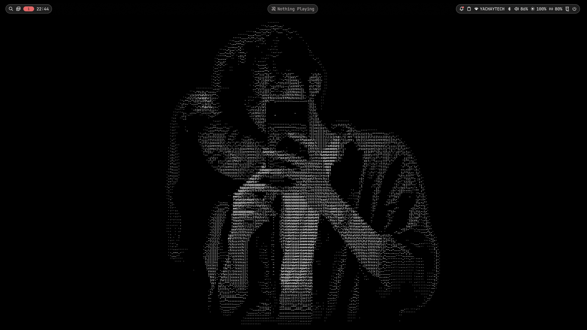

# 🌙 Moon dots

[English](README.md) | **Español**

Mi escritorio en **Debian 13 (trixie)** con **niri** + **Noctalia v5**, tema rojo y negro, montado desde una instalación mínima sin entorno gráfico.



| | |
|---|---|
| **Distro** | Debian 13 trixie (instalación mínima, sin escritorio) |
| **Compositor** | [niri](https://github.com/YaLTeR/niri) 26.04 (tiling con scroll, Wayland) |
| **Shell / barra** | [Noctalia](https://noctalia.dev) v5 |
| **Login** | greetd + tuigreet |
| **Terminal** | kitty (negro, 40% de opacidad, blur) |
| **Shell** | fish + starship |
| **Fetch** | fastfetch con el logo ASCII de Debian |
| **Fuente** | JetBrainsMono Nerd Font |
| **Equipo** | Acer Nitro V 15 (i5-13420H, RTX 4050 Max-Q, pantalla 165 Hz) |

La config de niri y la barra de Noctalia están basadas en [Spike-dotfiles](https://github.com/triplespike/Spike-dotfiles) de triplespike (NixOS), portadas a Debian y cambiadas a mi gusto.

---

## Qué tiene

- **Borde de la ventana activa** con degradado rojo (`#FF3B3B` a `#9B0012`), esquinas redondeadas, sombras y animaciones con resortes.
- **Barra de Noctalia en cápsulas**: launcher, wallpaper, workspaces y reloj a la izquierda; visualizador de audio y música al centro; bandeja, red, volumen, batería e idioma del teclado a la derecha.
- **Teclado** en inglés por defecto, con `Super+Shift+Space` para cambiar a español latinoamericano.
- **Terminal** kitty negra semitransparente (40%); el prompt de starship en una línea, en rojo.
- **fastfetch** limpio, en español, con el logo de Debian.
- **`batlim`**: comando para activar o quitar el límite de carga al 80% (laptops Acer).
- **`fixaudio`**: recupera los parlantes de la laptop cuando se pierden al conectar un monitor por DisplayPort.
- Apps Qt (OBS) y Electron (VS Code, Discord) forzadas a Wayland nativo.

## Estructura

```
.
├── install.sh                 # copia los dots a ~/.config (con respaldo) e instala lo que usan
├── sync.sh                    # trae tus configs de ~/.config al repo para commitear cambios
├── config/                    # todo lo que va en ~/.config
│   ├── niri/config.kdl
│   ├── noctalia/config.toml
│   ├── noctalia/palettes/Nullscapes.json
│   ├── kitty/kitty.conf
│   ├── fish/config.fish
│   ├── fish/functions/{batlim,fixaudio}.fish
│   ├── fastfetch/config.jsonc
│   └── starship.toml
├── system/                    # archivos de sistema (van fuera de $HOME)
│   ├── greetd/config.toml
│   └── udev/99-acer-wmi-battery.rules
└── scripts/
    ├── 01-base.sh             # niri, Noctalia, NetworkManager, portales, greetd
    ├── nvidia/
    │   ├── instalar-nvidia.sh # driver NVIDIA open + modeset para Wayland + suspensión
    │   └── arreglar-nvidia.sh # parche si DKMS falla con kernel 6.12.113 (ver abajo)
    ├── bateria-acer.sh        # módulo acer-wmi-battery con DKMS + permisos para batlim
    └── apps.sh                # Brave, VS Code, Docker, LaTeX, OBS, Flatpak, Steam, Claude Code
```

---

## Instalación desde cero

Parto de Debian 13 instalado con el ISO **netinst**, desmarcando todos los entornos de escritorio (solo "utilidades estándar del sistema").

### 0. Internet desde la TTY

Si el instalador configuró el WiFi en `/etc/network/interfaces` pero no hay red:

```bash
su -              # con el guion, si no root no tiene /usr/sbin en el PATH
ip a              # ver el nombre de la interfaz (ej. wlp62s0)
ifdown wlp62s0; ifup wlp62s0
ping -c 3 8.8.8.8
```

Si no hay forma, conecta el celular por USB con **anclaje USB** y haz `dhclient` a la interfaz nueva (`usb0` o `enx...`).

### 1. Clonar el repo

```bash
apt install git sudo
usermod -aG sudo TU_USUARIO     # y vuelve a entrar
git clone https://github.com/xMane13/dotfiles.git ~/dotfiles
cd ~/dotfiles
```

### 2. Escritorio base

```bash
sudo bash scripts/01-base.sh
```

Después pasa el WiFi a NetworkManager: comenta con `#` las líneas de la interfaz inalámbrica en `/etc/network/interfaces` y luego:

```bash
sudo systemctl restart NetworkManager
nmtui
```

### 3. Drivers NVIDIA

```bash
sudo bash scripts/nvidia/instalar-nvidia.sh
sudo reboot
```

Activa `contrib non-free`, instala el módulo **open** de NVIDIA, agrega `nvidia-drm.modeset=1 nvidia-drm.fbdev=1` al GRUB (necesario para Wayland) y habilita los servicios de suspensión.

> **Si DKMS falla al compilar el módulo** con el kernel `6.12.113+deb13`: ese kernel cambió la firma de `pci_resize_resource()` y el driver 550.163.01 no compila. `arreglar-nvidia.sh` parchea la fuente, termina la instalación y hace los pasos que faltaron:
> ```bash
> sudo bash scripts/nvidia/arreglar-nvidia.sh
> ```
> Está hecho para esa versión exacta del driver. Si Debian ya publicó un driver corregido, no hace falta.

### 4. Los dots

```bash
bash install.sh
```

Reinicia. Entras por tuigreet directo a niri con Noctalia.

### 5. Batería (solo laptops Acer)

```bash
sudo bash scripts/bateria-acer.sh
batlim on     # límite al 80%
batlim off    # carga hasta 100%
```

### 6. Programas

```bash
bash scripts/apps.sh
```

Pregunta grupo por grupo qué instalar.

---

## Solo quiero los dots

```bash
git clone https://github.com/xMane13/dotfiles.git ~/dotfiles
bash ~/dotfiles/install.sh --solo-dots
```

Todo lo que reemplaza queda respaldado en `~/.config/dots-backup-FECHA/`.

## Guardar cambios

Edita tus configs normalmente en `~/.config` y cuando quieras guardarlas:

```bash
cd ~/dotfiles
bash sync.sh
git diff
git commit -am "describe el cambio"
git push
```

---

## Atajos

`Super` es la tecla de Windows. `Super+Shift+/` muestra todos.

| Atajo | Acción |
|---|---|
| `Super+Enter` | Terminal |
| `Super+T` | Terminal flotante |
| `Super+B` | Brave |
| `Super+E` | Archivos |
| `Super+Space` / `Super+D` | Launcher de Noctalia |
| `Super+Shift+C` | Centro de control |
| `Super+N` | Ajustes de Noctalia |
| `Super+X` | Apagar / cerrar sesión |
| `Super+Tab` | Cambiar de ventana |
| `Super+Shift+Space` | Teclado inglés / español |
| `Super+Q` | Cerrar ventana |
| `Super+V` | Flotante / tiling |
| `Super+W` | Columna en pestañas |
| `Super+F` / `Super+Shift+F` | Maximizar / pantalla completa |
| `Super+R` | Cambiar ancho de la columna |
| `Super+O` | Vista general |
| `Super+H/L` o flechas | Moverse entre columnas |
| `Super+J/K` | Moverse dentro de la columna |
| `Super+Shift+H/L/J/K` | Mover la ventana |
| `Super+1..9` | Ir al workspace |
| `Super+Shift+1..9` | Mandar la ventana al workspace |
| `Super+U/I` o rueda del mouse | Workspace abajo / arriba |
| `Print` / `Super+Shift+S` | Captura de una región |
| `Ctrl+Print` / `Alt+Print` | Captura de pantalla / ventana |
| `Super+Shift+E` | Salir de niri |

---

## Problemas que encontré y cómo los resolví

<details>
<summary><b>apt: "Temporary failure resolving deb.debian.org"</b></summary>

No hay red. Ver el paso 0. Con `ip a` se ve si la interfaz tiene IP; `NO-CARRIER` en el WiFi significa que no está asociado a ninguna red.
</details>

<details>
<summary><b>"ifup: command not found" siendo root</b></summary>

Entraste con `su` en vez de `su -`. Sin el guion no se carga `/usr/sbin` en el PATH.
</details>

<details>
<summary><b>El repo de Noctalia da 404 ("does not have a Release file")</b></summary>

Los tutoriales viejos usan `https://pkg.noctalia.dev/apt`, que ya no existe. El nuevo es `noctalia-trixie.sources` con el keyring `nickh-archive-keyring.deb`, y el paquete ahora se llama `noctalia` (antes `noctalia-shell`). `01-base.sh` ya usa el correcto y borra el viejo.
</details>

<details>
<summary><b>Instalar niri se trajo medio GNOME</b></summary>

Por los paquetes recomendados. `01-base.sh` crea `/etc/apt/apt.conf.d/99norecommends` para que no vuelva a pasar. Si ya pasó: `sudo apt purge gdm3 gnome-shell gnome-session && sudo apt autoremove`, revisando que no se lleve `niri`, `noctalia` ni `xdg-desktop-portal-gnome`.
</details>

<details>
<summary><b>noctalia-greeter no se instala (libdrm2, libwayland)</b></summary>

Está compilado contra librerías más nuevas que las de trixie. Uso greetd + tuigreet, que está en los repos normales.
</details>

<details>
<summary><b>niri: "Failed to parse the config file"</b></summary>

`niri validate` dice la línea exacta. Casi siempre es un atajo repetido: comenta el original con `//`.
</details>

<details>
<summary><b>fish: "Expected a string, but found a redirection"</b></summary>

fish no entiende `<<'EOF'` (es de bash). Escribe `bash`, pega el comando y luego `exit`.
</details>

<details>
<summary><b>OBS no muestra "Captura de pantalla (PipeWire)"</b></summary>

Faltaba `obs-plugins` (con `--no-install-recommends` no entra) y OBS tiene que correr en Wayland. Lo segundo ya está en el bloque `environment` de `config.kdl`.
</details>

<details>
<summary><b>Se pierden los parlantes al conectar un monitor por DisplayPort</b></summary>

La tarjeta de Intel cree que conectaste audífonos y cambia a un perfil sin "Speaker", que además `pavucontrol` oculta. Solución: `fixaudio`, o en `pavucontrol` → Configuración desmarcar "Ocultar perfiles no disponibles" y elegir el perfil `HiFi (... Speaker)`.
</details>

<details>
<summary><b>La batería no pasa del 80%</b></summary>

El límite queda guardado en el firmware aunque reinstales. Instala el módulo con `scripts/bateria-acer.sh` y haz `batlim off`.
</details>

---

## Personalizar

- **Idioma de Noctalia:** está en español con `lang = "es"` en `[shell]` de `config/noctalia/config.toml`; bórralo para que siga el idioma del sistema.
- **Colores de Noctalia:** la paleta es `config/noctalia/palettes/Nullscapes.json` (azul y morado, de los dots originales). Cambia `mPrimary`, `mSecondary` y `mTertiary` para llevarla a rojo.
- **Transparencia de la terminal:** `background_opacity` en `config/kitty/kitty.conf`.
- **Borde:** `focus-ring` en `config/niri/config.kdl`.

## Créditos

- [triplespike/Spike-dotfiles](https://github.com/triplespike/Spike-dotfiles): base de la config de niri, la barra de Noctalia y la paleta Nullscapes.
- [niri](https://github.com/YaLTeR/niri) y [Noctalia](https://github.com/noctalia-dev/noctalia).
- [frederik-h/acer-wmi-battery](https://github.com/frederik-h/acer-wmi-battery): módulo para el límite de carga en Acer.
- Paquetes de niri para Debian del repo [DankLinux (AvengeMedia)](https://build.opensuse.org/project/show/home:AvengeMedia:danklinux).

Licencia MIT.
